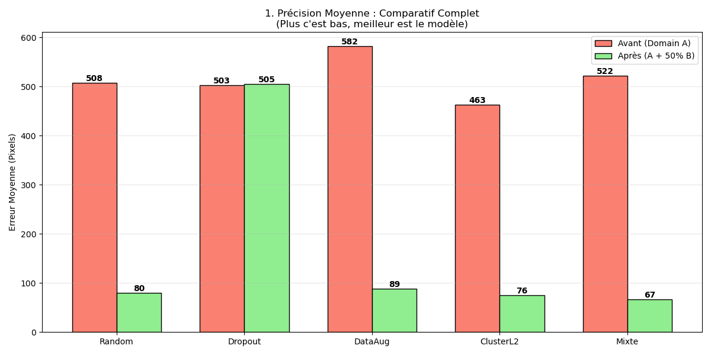
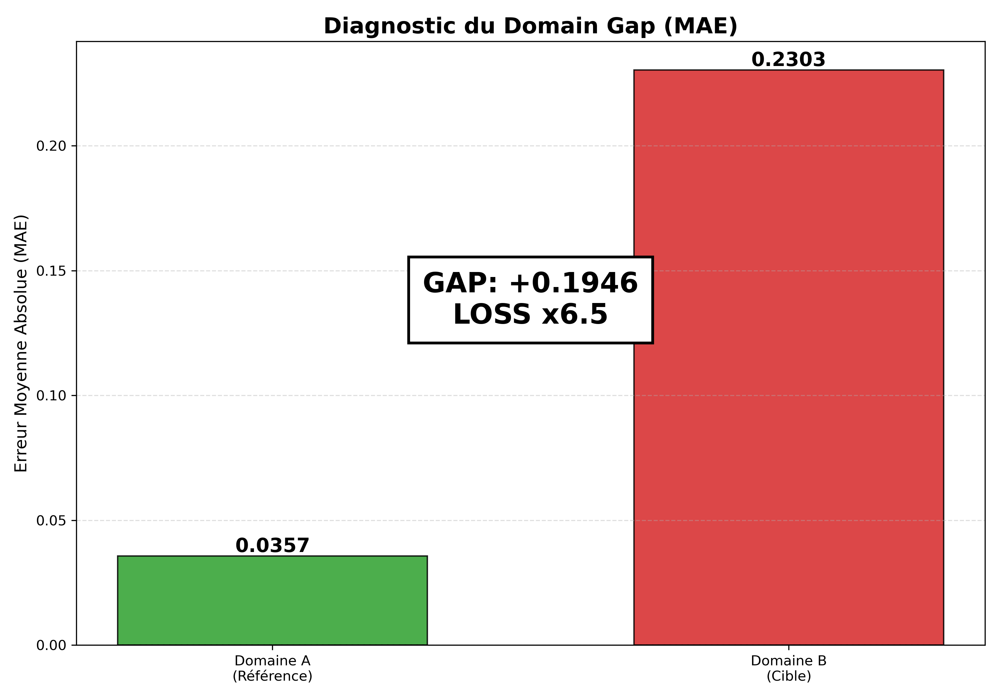
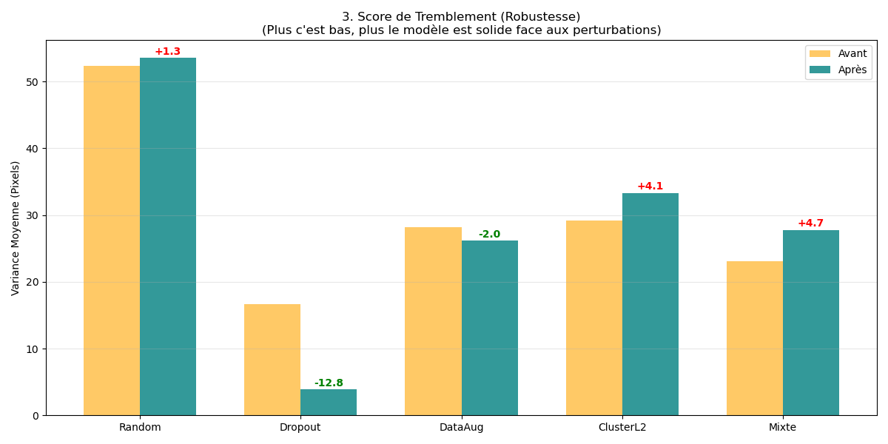
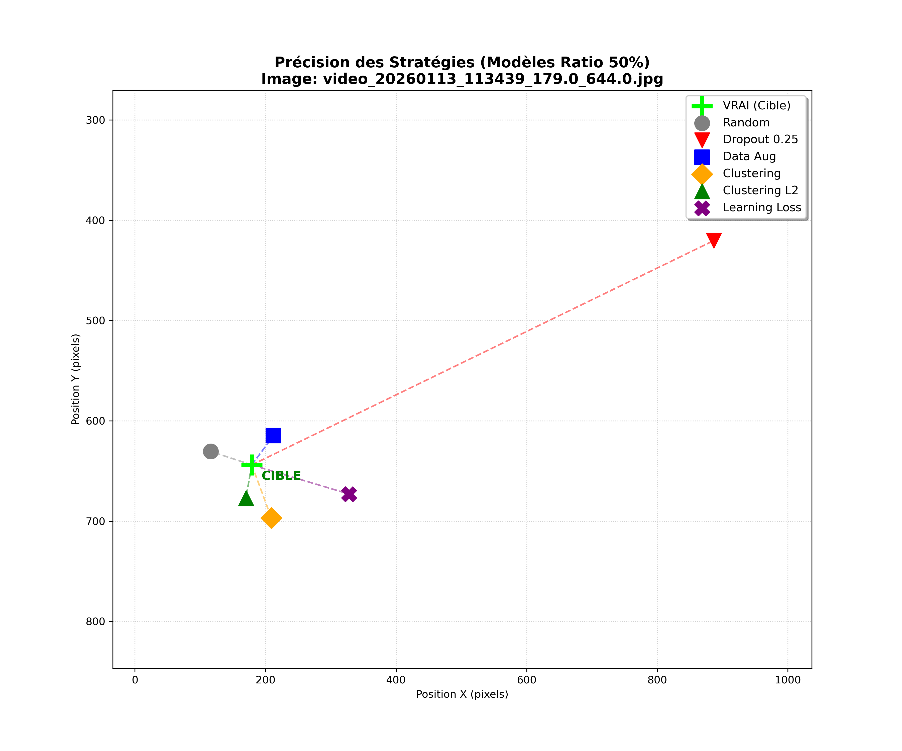

<picture><source media="(prefers-color-scheme: dark)" srcset="https://raw.githubusercontent.com/ThibPltt/ThibPltt/main/assets/repos/ActiveLearning-dark.svg"><source media="(prefers-color-scheme: light)" srcset="https://raw.githubusercontent.com/ThibPltt/ThibPltt/main/assets/repos/ActiveLearning-light.svg"></picture>

# Active Learning · gaze tracking

Predicting where a person looks on screen from a webcam image, while labelling as few new images as possible.



| At a glance | |
|---|---|
| **Dates** | January – February 2026 |
| **Context** | deep learning · course project · ENSIM / Le Mans Université, 5th year |
| **Technologies** | Python · PyTorch · Hugging Face Transformers (ResNet-18) · scikit-learn · Matplotlib |
| **Supervisor** | Meysam Shamsi |

## Problem

A webcam is far cheaper than an infrared eye tracker, but a model that predicts the gaze from a webcam image loses its accuracy as soon as the person, the light, the background or the accessories change. Labelling new images for every new condition is slow. Which images are worth labelling first?

## Role

Course project, ENSIM 5th year. The dataset was recorded and prepared together with Arthur Lecureur and Suzanne G-C (branch `main`); each student then ran their own study on their own branch. This branch, `Thibaut`, holds mine: the training protocol, the selection strategies, the evaluation and the bias analysis.

## Decisions

- **Regression rather than classification:** a pretrained ResNet-18 (`microsoft/resnet-18`) whose head outputs the (x, y) position of the gaze, normalised on a 1920 × 1080 screen.
- **Two domains:** domain A, one person, used to train the starting model; domain B, several people and conditions, used as the pool of images to label and as the final test.
- **A fair protocol:** domain A split 75 % train / 25 % test, domain B split 80 % pool / 20 % test; images are added to the training set step by step (1, 2, 5, 10, 20 then 50 % of the pool), 20 epochs per step, 3 repetitions per strategy, and every score is measured on the test sets only.

## Result

A model trained only on domain A makes 6.5 times more error on domain B (MAE 0.0357 against 0.2303): the domain gap is real. Once half of the pool is labelled, the **mixed strategy** (clustering L2 + data augmentation) gives the best accuracy, **67 px** of mean error, against 80 px when the images are picked at random. MC Dropout fails: the model collapses towards the centre of the screen.

## The strategies

| Strategy | Family | How images are chosen |
|---|---|---|
| Random | baseline | Picked at random in the pool. |
| MC Dropout (0.5 and 0.25) | uncertainty | 10 predictions with dropout on; the images with the most spread are labelled. |
| Data augmentation | uncertainty | 10 altered copies of each image (light noise, brightness); the images whose predictions vary most are labelled. |
| Clustering, Clustering L2 | diversity | K-means on the image features (with or without L2 normalisation); the image closest to each centre is labelled. |
| Learning Loss | uncertainty | A small extra head learns to predict the model’s own error. |
| Mixed (L2 + DA) | hybrid | Uncertainty first: the 3× most uncertain images (data augmentation) are kept, then one image per cluster among them (clustering L2). |

## Results

Mean error on the domain B test set, in pixels on a 1920 × 1080 screen, before (domain A only) and after adding 50 % of the pool:

| Strategy | Before | After |
|---|---|---|
| Random | 508 | 80 |
| MC Dropout | 503 | 505 |
| Data augmentation | 582 | 89 |
| Clustering L2 | 463 | 76 |
| **Mixed (L2 + DA)** | 522 | **67** |

For reference, a prediction drawn completely at random is 772 px off on average (`dummy_test.py`).



**Robustness.** Accuracy has a cost: the mixed strategy makes the model slightly more sensitive to perturbations (+4.7 px of jitter), while data augmentation is the only accurate strategy that makes it steadier (−2.0 px). The drop for MC Dropout (−12.8 px) only reflects its collapse towards the centre.



**Biases.** All models predict the top-left corner of the screen better. Across the four people of domain B, the mixed strategy spreads the error more evenly, whereas MC Dropout fails for everyone.



## In this repository

| Path | Content |
|---|---|
| `IA_training/*Training.py` | One script per strategy (`randomTraining.py`, `dropoutTraining.py`, `dataAugmTraining.py`, `clusteringTraining.py`, `learningLossTraining.py`, `mixedTraining.py`…), their logs, `resultats_*.csv` and `benchmark_*.png`. |
| `IA_training/analyze_final.py` | Comparison charts across strategies (`FULL_1_MOYENNES.png`, `FULL_2_DISTRIBUTIONS.png`, `FULL_3_ROBUSTESSE.png`). |
| `analyze_bias.py`, `visualize_dispersion.py`, `compare_predictions_ratio50.py` | Spatial and identity biases, predictions of every model on the same image. |
| `dummy_test.py`, `diagnostic.py`, `get_training_time.py` | Random-guess baseline, domain gap check, training times. |
| `DataCollection/`, `DataProcessing/`, `processed_frames/` | Recording (a point bounces across the screen while the webcam films the face) and the extracted frames. |
| `IA_training/best_models_*` | The best model saved at each step, for each strategy. |
| `Notes.txt`, [`README.fr.md`](README.fr.md) | My working notes and the original README, in French. |

## Run it

```bash
pip install torch torchvision transformers scikit-learn matplotlib seaborn pandas tqdm pillow

# 1. Build the splits: set project_root at the top of split_folders.py to your clone,
#    it creates FINAL_DATASET/ next to the repository from processed_frames/
python split_folders.py

# 2. Train one strategy (writes best_models_<strategy>/ and resultats_<strategy>.csv)
cd IA_training
python mixedTraining.py

# 3. Compare the strategies
python analyze_final.py
```

A CUDA GPU is strongly advised; the scripts fall back to the CPU otherwise.

## Credits

Course project at ENSIM / Le Mans Université, supervised by Meysam Shamsi. Dataset recorded with Arthur Lecureur and Suzanne G-C; the other studies are on the `Arthur` and `Suzanne` branches. The full history comes from the original repository, [Lecureur-Arthur/ActiveLearning](https://github.com/Lecureur-Arthur/ActiveLearning). References: Tharwat & Schenck (2023), *A Survey on Active Learning*, Mathematics; Seoh (2020), *Qualitative analysis of Monte Carlo dropout*, arXiv.
