<a href="https://thibautplatet.com/en/projects/active-learning.html"><picture><source media="(prefers-color-scheme: dark)" srcset="https://raw.githubusercontent.com/ThibPltt/ThibPltt/main/assets/repos/ActiveLearning-dark.svg"><source media="(prefers-color-scheme: light)" srcset="https://raw.githubusercontent.com/ThibPltt/ThibPltt/main/assets/repos/ActiveLearning-light.svg"></picture></a>

# Active Learning · eye-tracking prediction

Predicting where a person looks on the screen with a plain computer camera, choosing the images worth training on through active learning.

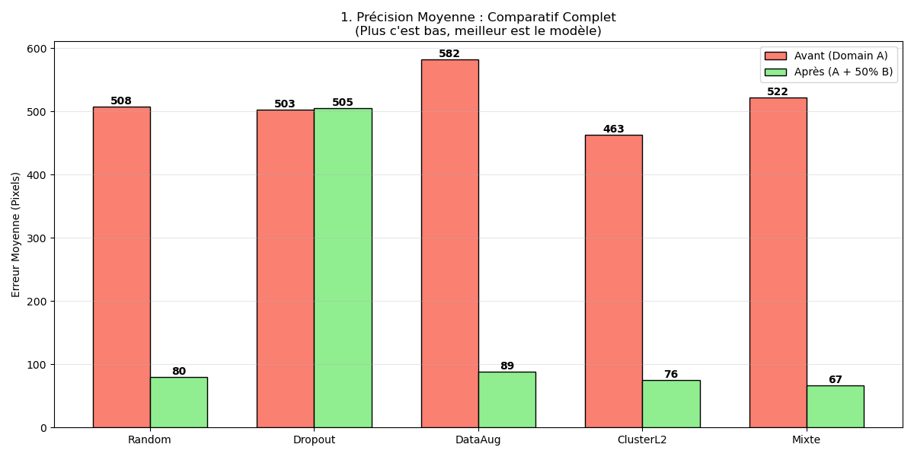

| At a glance | |
|---|---|
| **Dates** | 2026 |
| **Context** | active learning · personal study, data recorded as a team of 3 · ENSIM |
| **Technologies** | Active Learning · Deep Learning · ResNet-18 · Python · PyTorch |
| **Case study** | [thibautplatet.com/en/projects/active-learning.html](https://thibautplatet.com/en/projects/active-learning.html) |
| **Supervisor** | Meysam Shamsi |

## Problem

Eye-tracking devices rely on infrared cameras, which are costly and need calibrating. Can a plain camera and an AI replace them, and does active learning help when the person, the background, the light or the accessories change?

## Role

Final-year course project: the dataset was recorded as a team of 3, then each student ran their own study. Mine, on this branch: training protocol, selection strategies, evaluation and bias analysis.

## Decisions

A regression with a ResNet-18 that predicts the coordinates of the point being looked at; a reference domain (one person) and a target domain (four people, two computers, varied backgrounds, accessories and light); each strategy retrained from scratch, in steps from 1 to 50% of the target domain, three times to measure the standard deviation.

## Result

Without new images, the error is 6.5 times higher on the target domain. Clustering with L2 normalisation reaches the lowest error (MAE 0.0331 against 0.0362 at random), but random selection wins almost every time: in this context, the starting hypothesis is not confirmed.

## The idea

The goal: an eye-tracking system with a plain computer camera. The face of a person following a moving point on the screen with their eyes is filmed; an AI then learns, image by image, to find where they are looking. A standard camera would make the experiment simpler to set up, cheaper and greener than infrared devices.

Active learning targets, among a large number of images, those that bring the most information to the model. The study’s hypothesis: it helps predict the coordinates of the point being looked at.

## Capturing the images

Each recording lasts 30 seconds. The person, sitting in front of a laptop screen, keeps still: only their gaze follows the point.

- The point bounces off the edges of the screen and changes colour, like the DVD logo; its path is drawn at random for each recording.
- The computer’s camera films the face while the coordinates of the point are recorded alongside.
- The videos are cut into images, each carrying the point’s coordinates in its name. Every image is handled on its own, not as part of a sequence.

## Data and protocol

Two domains. Domain A, one person in a single setting, is the reference. Domain B brings together four people and twelve recordings: two computers, two backgrounds (classroom, white wall), accessories (cap, glasses, mask) and bright or dim light.

| Images | Domain A | Domain B |
|---|---|---|
| Training | 647 | 8,202 |
| Test | 216 | 2,051 |

Domain A: three quarters of the images for training, one quarter for the test. Domain B: 80% make up the pool the strategies draw from, 20% the test.

- **Model:** a ResNet-18 (`microsoft/resnet-18`) used for regression, which predicts for each image the coordinates of the point on the screen.
- **Training:** 20 epochs, batches of 10 images, a learning rate of 0.0001, the mean absolute error (MAE) as loss and the AdamW optimiser.
- **Steps:** training on domain A, then 1, 2, 5, 10, 20 and 50% of domain B added incrementally; each step keeps the images of the previous ones. The loss is measured on the domain B test set.
- **Repetitions:** three, with different seeds, to compute a standard deviation and check that a result is not a lucky draw.
- **Fair start:** each strategy starts from scratch; starting from a model already trained by another strategy would bias the comparison.
- **Time:** about 15 minutes for the first training on domain A, 1 h 40 on average for a strategy’s full session.

Two starting measures. A dummy model, which points at random on the screen without looking at the images, is 772 pixels off on average. The model trained on domain A alone makes 6.5 times more error on domain B than on A: it has learnt domain A, and domain B remains to be learnt.

<table>
<tr>
<td width="50%">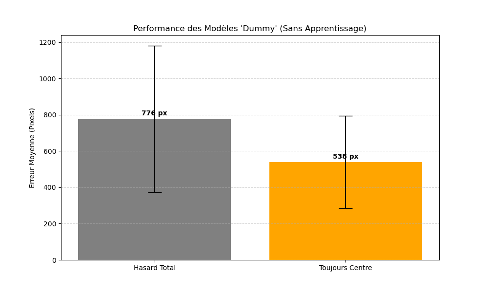</td>
<td width="50%">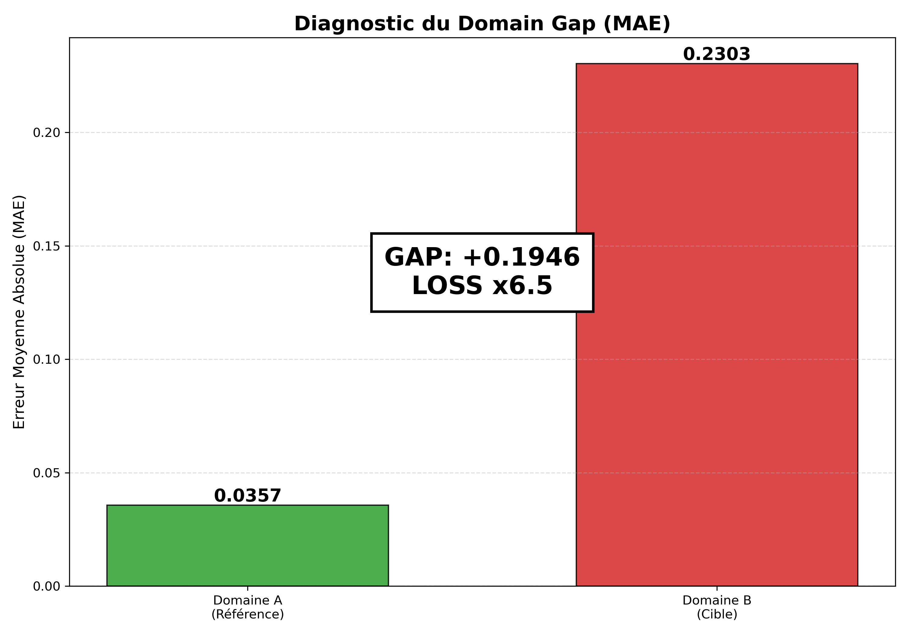</td>
</tr>
<tr>
<td align="center"><sub>The dummy model: 772 px off on average.</sub></td>
<td align="center"><sub>The model trained on domain A: MAE 0.0357 on A, 0.2303 on B.</sub></td>
</tr>
</table>

## The strategies compared

Each strategy picks the images of domain B to add to the training set. All of them are compared with random selection.

| Strategy | Family | How the images are chosen |
|---|---|---|
| **Random** | reference | At random in the pool. |
| **MC Dropout** (50% and 25%) | uncertainty sampling | Ten predictions per image, with neurons switched off at random; the images where they vary most, those the model is not sure of, are kept. |
| **Data Augmentation** | uncertainty sampling | Ten copies of each image, brighter or darker, noisy or blurred; the images with the least stable predictions are kept. |
| **Clustering** (K-Means, then L2 normalisation) | diversity sampling | The images are grouped into clusters; the sample closest to the centre of each cluster is kept. |
| **Learning Loss** | predict its own errors | The model predicts the error it will make; the images with the largest expected errors are kept. |
| **Mix** | clustering L2 + Data Augmentation | Data Augmentation spots the most problematic images, clustering picks the most varied among them. |

On the charts below: across, the percentage of domain B added to the training set; up, the MAE loss on the test set (lower is better). The vertical bars give the standard deviation over the three repetitions, the stars the best result obtained (chart labels in French).

## The reference: random

The simplest strategy: images taken at random from domain B. Its curve is the reference for all the others. Training: 1 h 13.

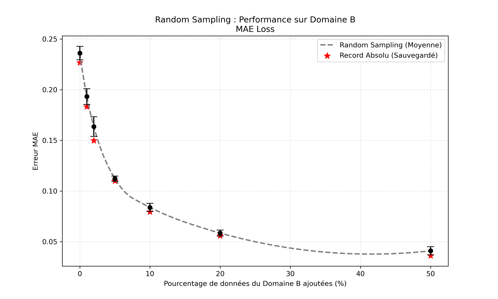

<sub>Random selection on domain B: mean of the three repetitions and best result (red stars).</sub>

## Uncertainty sampling: the model is not sure of a label

**MC Dropout.** Two settings: 50% then 25% of the neurons switched off, to create variation. Neither does better than random, but 25% beats 50%: switching off too many neurons biases the model, which no longer links the images together and does not learn to predict the right coordinates. Training: 1 h 18.

**Data Augmentation (adversarial data).** Each image is copied ten times, with a changed brightness or added blur, and the model predicts the coordinates on every copy: a way to cope with brightness and contrast issues, and to focus on the pupil rather than the pixels. Mixed results: no better loss than random. Training: 1 h 46.

<table>
<tr>
<td width="50%">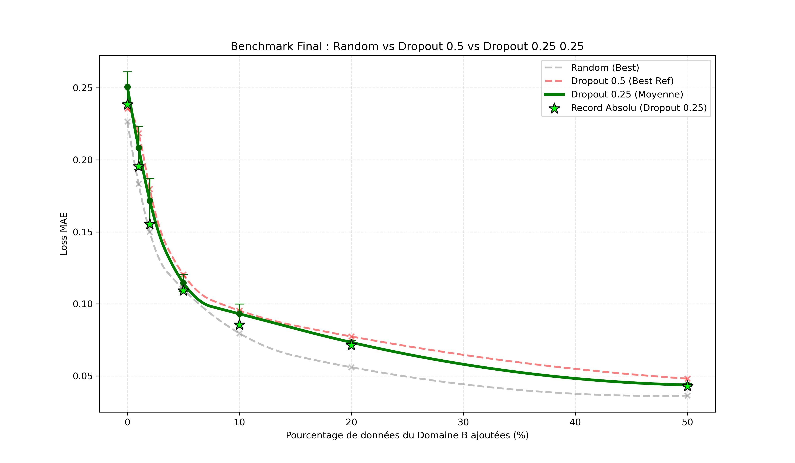</td>
<td width="50%">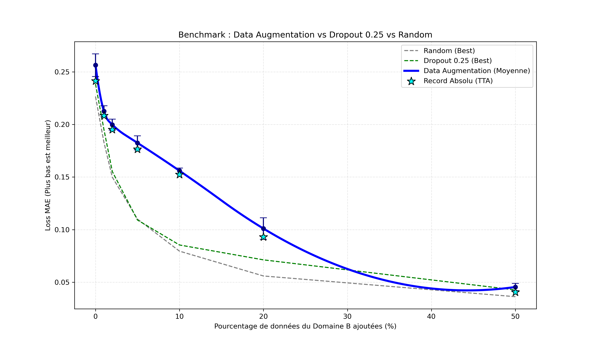</td>
</tr>
<tr>
<td align="center"><sub>MC Dropout 25% (green), against random and Dropout 50%.</sub></td>
<td align="center"><sub>Data Augmentation (blue), against random and Dropout 25%.</sub></td>
</tr>
</table>

## Diversity sampling: the model looks for new labels

The family with the most satisfying results. Two approaches:

- **K-Means**, which splits the whole set of images into clusters. It links images with close features (a short distance to the centre): it diversifies little and focuses on what they have in common.
- **K-Means with L2 normalisation:** every image is brought to the same norm, as if on a sphere. What then counts is how its features differ, hence a true geometric diversity and better learning. There are as many clusters as images to pick.

With 50% of domain B, clustering L2 does better than random: a loss of 0.0331 against 0.0362. Training: 2 h 40.

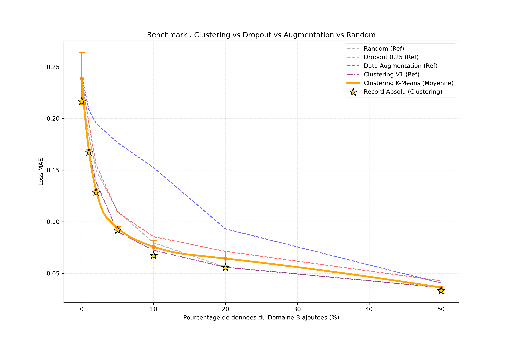

<sub>Clustering with L2 normalisation (orange), against random, Dropout 25%, Data Augmentation and the first clustering.</sub>

## Predict its own errors: Learning Loss

The model tries to reduce two errors at once: that of the coordinates, and that of the prediction of its own error. This second module, very noisy at first, takes over the learning: the model focuses on predicting its error and neglects the coordinates. The method suits classification (a cat or a dog) better than an error in pixels, which is less clear-cut. Training: 1 h 50.

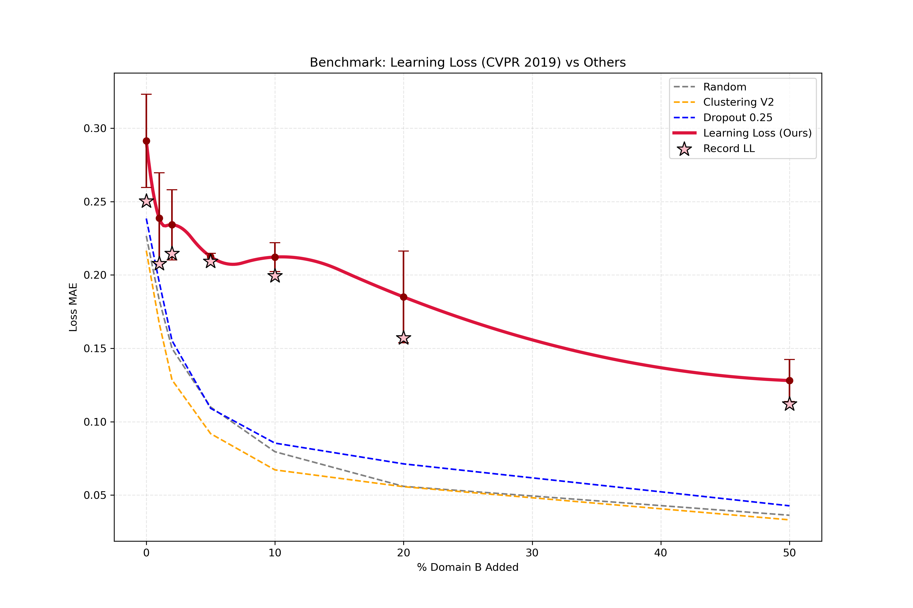

<sub>Learning Loss (red), against random, clustering and Dropout 25%.</sub>

## Mixing the best strategies

A last attempt: combining an uncertainty strategy and a diversity strategy, those that gave the best predictions. Data Augmentation spots the most problematic images, then clustering L2 picks the most varied among them. Training: 2 h 34. This last training does not beat random selection.

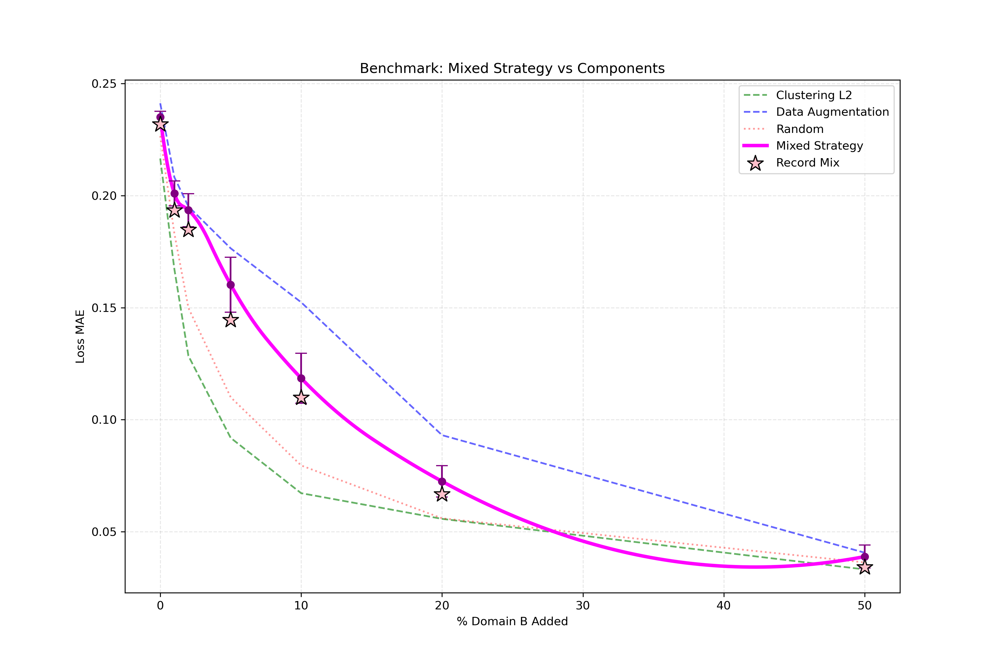

<sub>The mix (magenta), against its two components and random.</sub>

## Results

| | |
|---|---|
| **× 6.5** | more error on domain B for the model trained on domain A alone (MAE 0.2303 against 0.0357) |
| **772 px** | mean error of a dummy model pointing at random |
| **0.0331** | best loss with 50% of domain B: clustering L2 (0.0362 at random) |
| **10,253** | images in domain B, for four people and twelve settings |

| MAE loss with 50% of domain B | Loss |
|---|---|
| Random | 0.0362 |
| Dropout 25% | 0.0427 |
| Data Augmentation | 0.0406 |
| **Clustering L2** | **0.0331** |
| Learning Loss | 0.1121 |
| Mix (L2 + Data Augmentation) | 0.0341 |

To compare the predictions in pixels, each best model (the one at 50% of domain B) predicted the coordinates on every test image of domain B: the chart at the top gives the mean error of each strategy, before and after adding 50% of domain B. Almost every strategy brings the error far below that of the starting model, but compared with random, they do not always do better.

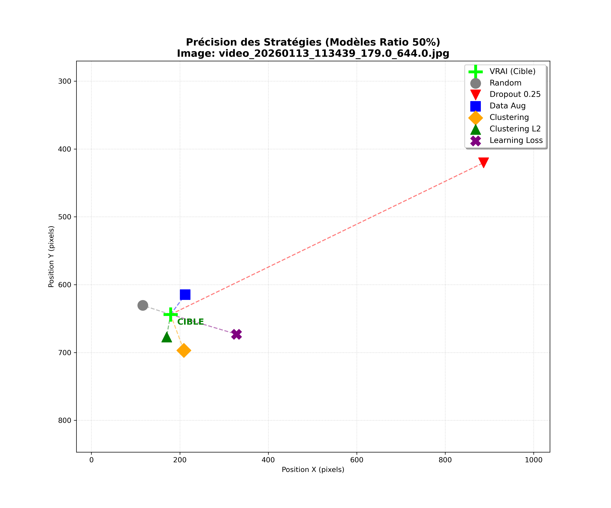

<sub>The predictions of the eight models for the same image, around the true position of the point.</sub>

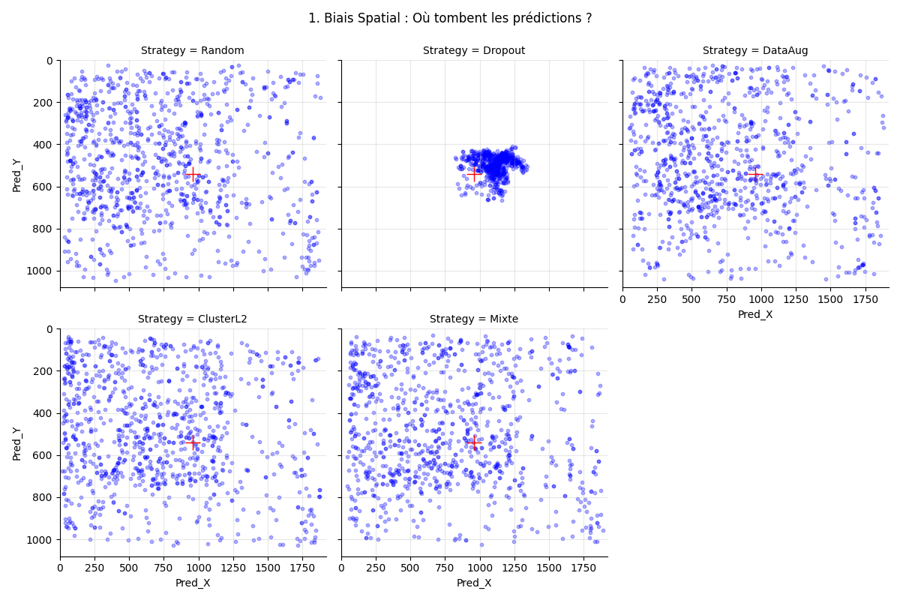

<sub>Where each strategy’s predictions land: the top-left corner of the screen is over-represented, which biases the results.</sub>

**Conclusion.** In this precise context, active learning strategies do not prove better than random selection, which wins almost every time: the starting hypothesis is not confirmed.

## In this repository

| Path | Content |
|---|---|
| `IA_training/*Training.py` | One script per strategy (`randomTraining.py`, `dropoutTraining.py`, `dataAugmTraining.py`, `clusteringTraining.py`, `learningLossTraining.py`, `mixedTraining.py`…), their logs, `resultats_*.csv` and `benchmark_*.png`. |
| `IA_training/analyze_final.py` | Comparison charts across strategies (`FULL_1_MOYENNES.png`, `FULL_2_DISTRIBUTIONS.png`, `FULL_3_ROBUSTESSE.png`). |
| `analyze_bias.py`, `visualize_dispersion.py`, `compare_predictions_ratio50.py` | Spatial and identity biases, predictions of every model on the same image. |
| `dummy_test.py`, `diagnostic.py`, `get_training_time.py` | Random-guess baseline, domain gap check, training times. |
| `DataCollection/`, `DataProcessing/`, `processed_frames/` | Recording (the bouncing point and the webcam) and the extracted frames. |
| `IA_training/best_models_*` | The best model saved at each step, for each strategy. |
| `Notes.txt`, [`Historic_README.md`](Historic_README.md) | My working notes and the original README, in French. |

The branch `main` holds the shared dataset; `Arthur` and `Suzanne` hold the other two studies.

## Run it

```bash
pip install -r requirements.txt

# 1. Build the splits: creates FINAL_DATASET/ next to the repository from processed_frames/
python split_folders.py

# 2. Train one strategy (writes best_models_<strategy>/ and resultats_<strategy>.csv)
cd IA_training
python clusteringTraining.py

# 3. Compare the strategies
python analyze_final.py
```

A CUDA GPU is strongly advised; the scripts fall back to the CPU otherwise. The repository weighs about 7 GB because of the saved models.

## Credits

Final-year course project at ENSIM / Le Mans Université, supervised by Meysam Shamsi. Dataset recorded with Arthur Lecureur and Suzanne G-C. The full history comes from the original repository, [Lecureur-Arthur/ActiveLearning](https://github.com/Lecureur-Arthur/ActiveLearning). References: Tharwat & Schenck (2023), *A Survey on Active Learning*, Mathematics; Seoh (2020), *Qualitative analysis of Monte Carlo dropout*, arXiv.

## Licence

Released under the [MIT licence](LICENSE).

<details>
<summary>🇫🇷 En bref</summary>

Prédire où une personne regarde sur l’écran avec une simple caméra d’ordinateur, en choisissant par apprentissage actif les images utiles à l’entraînement (Python, PyTorch, ResNet-18). Projet de cours de dernière année à l’ENSIM (2026) : le jeu de données a été enregistré en équipe de 3, puis chacun a mené sa propre étude. Fiche complète sur [thibautplatet.com](https://thibautplatet.com/projets/active-learning.html).
</details>
